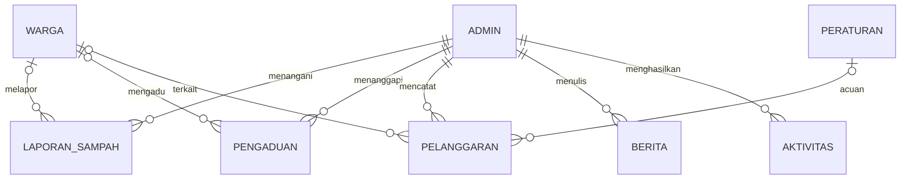

# Sistem Informasi RT/RW Peduli Lingkungan

Aplikasi PHP native dan MySQL untuk informasi lingkungan, laporan sampah, pengaduan warga, pencatatan dugaan pelanggaran secara terbatas, peraturan, berita, dan rekapitulasi. Seluruh contoh identitas dalam database adalah data dummy.

## Struktur Proyek

```text
.
├── index.php, detail_berita.php, detail_peraturan.php
├── buat_laporan.php, buat_pengaduan.php
├── config/koneksi.php
├── includes/{fungsi,navbar,footer}.php
├── assets/{css,js,img}/
├── uploads/{laporan_sampah,bukti_pengaduan,bukti_pelanggaran,berita}/
├── database/database.sql
└── admin/
    ├── login.php, proses_login.php, logout.php, dashboard.php
    ├── modul.php                 # CRUD warga, sampah, pengaduan, dugaan, aturan, berita, aktivitas
    ├── ganti_kata_sandi.php, lihat_bukti.php
    ├── template/{header,sidebar,footer}.php
    └── laporan/{index,cetak}.php
```

## Analisis Kebutuhan

- Warga dapat mengirim laporan sampah dan pengaduan tanpa mengirim NIK, KK, atau nama.
- Pengurus meninjau laporan, mengubah status, memberi tanggapan, mengelola peraturan/berita, dan membaca rekap.
- Catatan dugaan pelanggaran dibatasi untuk Admin, Ketua RT, dan Ketua RW; catatan ini tidak dipublikasikan.
- Role Petugas Kebersihan hanya diberi akses laporan sampah, pengaduan, dan rekap.
- Perubahan data memakai CSRF, query PDO, validasi server, audit, dan pembatasan tipe/ukuran unggahan.

## Relasi Tabel



Relasi ke warga/pengurus/peraturan menggunakan `ON DELETE SET NULL` agar laporan dan riwayat tidak ikut terhapus. Akun pengurus yang dihapus tetap meninggalkan catatan aktivitas tanpa referensi identitas.

## Instalasi XAMPP

1. Instal XAMPP dengan PHP 8.3 dan MariaDB/MySQL; aktifkan Apache dan MySQL.
2. Letakkan folder proyek di `C:\xampp\htdocs\sistem_rt_rw` (atau gunakan nama folder workspace ini).
3. Buka `http://localhost/phpmyadmin`, lalu impor `database/database.sql`.
4. Periksa `config/koneksi.php`. Pengaturan default XAMPP adalah host `127.0.0.1`, user `root`, password kosong, database `db_rt_rw`.
5. Pastikan ekstensi PHP `pdo_mysql`, `fileinfo`, dan `mbstring` aktif serta `AllowOverride All` berjalan agar aturan `.htaccess` diterapkan.
6. Buka `http://localhost/sistem_rt_rw/`. Halaman masuk pengurus berada di `/admin/login.php`.
7. Akun dummy: username `admin`, kata sandi `password`. Segera ganti lewat `/admin/ganti_kata_sandi.php`; kata sandi baru minimal 12 karakter.

## Rute Utama

- Publik: `/`, `/detail_berita.php?slug=...`, `/detail_peraturan.php?id=...`
- Kirim laporan: `/buat_laporan.php`; pengaduan: `/buat_pengaduan.php`
- Cek perkembangan laporan/pengaduan: `/status_laporan.php` menggunakan kode acak yang diberikan setelah pengiriman.
- Admin: `/admin/login.php`, `/admin/dashboard.php`
- CRUD: `/admin/modul.php?modul=warga|sampah|pengaduan|pelanggaran|peraturan|berita|aktivitas`
- Rekap: `/admin/laporan/index.php`; format cetak: `/admin/laporan/cetak.php`

Penghapusan hanya untuk Admin dan Ketua RW. Peraturan dan berita dapat diedit Admin, Ketua RT, atau Ketua RW sesuai role yang diizinkan pada modul. Sanksi tidak ditetapkan otomatis; isikan hanya bila didukung dasar yang sah.

## Pengujian Fitur

1. Masuk dengan akun demo lalu ganti kata sandi.
2. Periksa dashboard, statistik, dan grafik laporan bulanan.
3. Tambah, cari, filter, edit, dan hapus data warga; verifikasi akses berbeda dengan role Petugas.
4. Kirim laporan sampah dan pengaduan melalui halaman publik, lalu tinjau dan ubah status sebagai pengurus.
5. Pastikan status Ditolak menolak penyimpanan tanpa alasan.
6. Tambah catatan dugaan, ubah status verifikasi, dan pastikan tidak muncul di halaman publik atau rekap umum.
7. Tambah/nonaktifkan peraturan; buat berita draft lalu terbitkan dan periksa halaman publik.
8. Uji filter rekap, cetak, akses bukti setelah login, logout, dan proteksi CSRF.

## Pemecahan Masalah

- Koneksi gagal: pastikan MySQL aktif, database sudah diimpor, dan kredensial di `config/koneksi.php` sesuai.
- `could not find driver`: aktifkan `pdo_mysql` pada `php.ini`, lalu restart Apache.
- Unggahan gagal: aktifkan `fileinfo`, pastikan folder `uploads` dapat ditulis oleh Apache, dan cek `upload_max_filesize`/`post_max_size`.
- Bukti tidak dapat dibuka langsung: ini disengaja; masuk sebagai role yang berwenang dan buka melalui tombol bukti di modul.
- Perubahan skema setelah aplikasi berjalan: backup database dahulu dan buat migrasi terpisah; jangan impor ulang skrip ke database yang telah berisi data.

## Catatan Keamanan

Ganti kata sandi demo sebelum penggunaan, atur password database nonkosong, gunakan HTTPS di server publik, backup database terjadwal, dan sesuaikan role/keputusan peraturan dengan kewenangan serta musyawarah warga. Data dan peraturan contoh bukan dasar hukum.